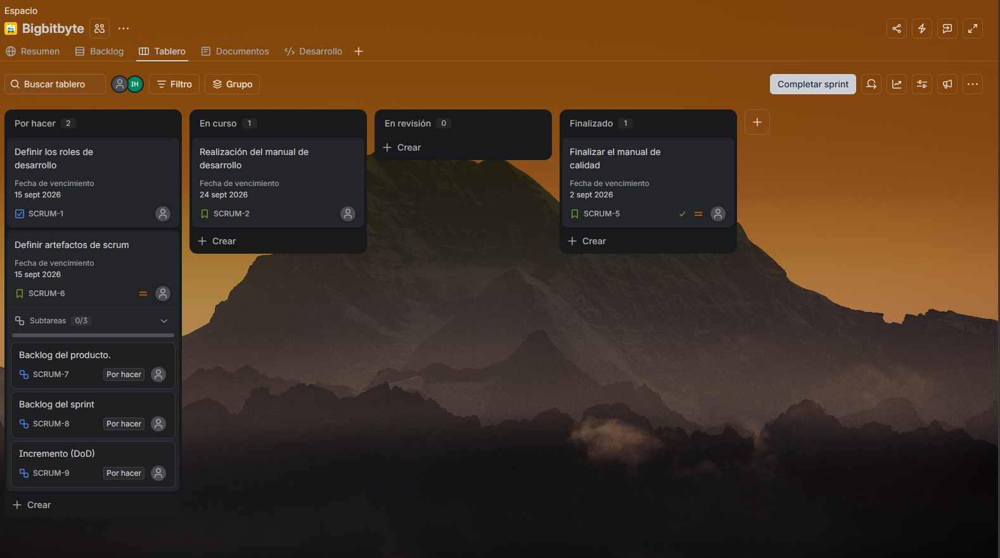
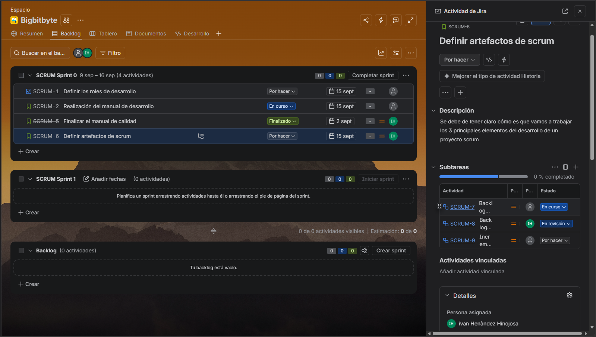
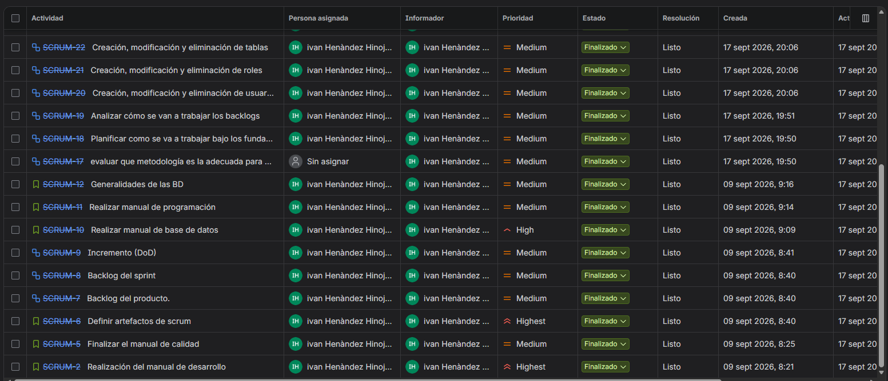
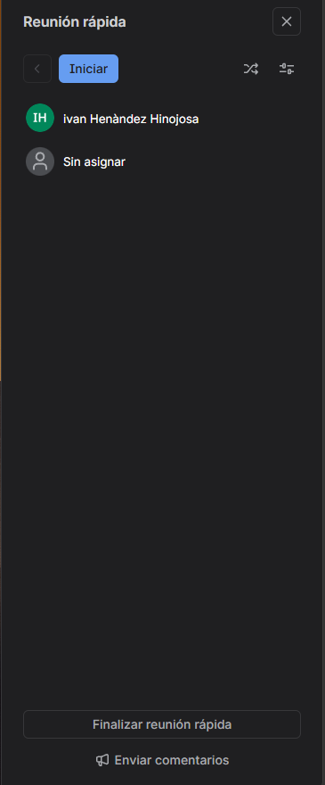
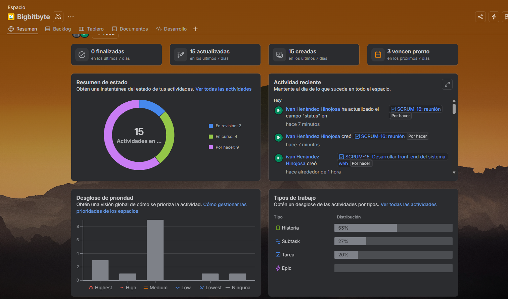

**  ****Ingen****iería**** en software**
**Unidad de aprendizaje:**
**Auditoria de sistemas**
**Empresa ****Bigbitbyte**
**Profesor:**

**Mauro Sánchez Sánchez**
**Manual de desarrollo.**
**Estudiantes****:**
Ivan Hernández Hinojosa
Jorge Darien Cabrera Bastidas
Carlos González Laines
**Fecha de entrega:** **22****/****Septiembre****/202****6**

# Elaboración

El presente manual fue elaborado por el equipo de Bigbitbyte, integrado por:

| N.° | Integrantes |
| --- | --- |
| 1 | Jorge Darien Cabrera Bastidas |
| 2 | Carlos Gonzales Laines |
| 3 | Ivan Hernandez Hinojosa |

> **Ilustración 1. Tabla de Elaboración**

# Control de Versiones

La siguiente tabla registra el historial de cambios del presente manual, Toda
modificación posterior a su aprobación debe quedar asentada en la siguiente tabla:

| Versión | Fecha | Autor | Descripción |
| --- | --- | --- | --- |
| 1.0 | 9/09/2026 | Ivan Hernandez | Primera versión y creación de manual de desarrollo posterior al acuerdo de metodología a usar con el equipo. |
| 2.0 | 16/09/2026 | Ivan Hernandez y Jorge Cabrera | Revisión del documento y corrección en los formatos de los documentos. |
| 3.0 | 20/09/2026 | Ivan Hernandez y Jorge Cabrera | Ultima revisión de los manuales. |
| 4.0 | 07/10/2026 | Ivan Hernandez | Corrección del manual y añadido de los formatos. |

> **Ilustración 2. Tabla de control de versiones**

Tabla de contenido
Tabla de ilustraciones

> **Ilustración 1. Tabla de Elaboración PAGEREF _Toc242254546 \h 2**

> **Ilustración 2. Tabla de control de versiones PAGEREF _Toc242254547 \h 2**

# 1. Metodología a utilizar

El equipo acordó que se trabajara con la metodología SCRUM, al tratar de una metodología ágil adaptada al desarrollo que necesitamos finalizar.
Para facilitar de desarrollo de esta metodología se va a utilizar una herramienta adicional para la gestión, la cual será Jira bajo el siguiente enlace de consulta: https://bit.ly/4hl9KSn
El espacio de Jira nos permitirá tener un registro de fechas, sprints, seguimiento del estado de las actividades y principales elementos de como se va llevando el proyecto.

> **Ilustración 3 Ejemplo de la forma en que se trabaja en Jira**

En la ilustración anterior se puede ver cómo está integrado el espacio en un tablero donde se tienen separados los segmentos de estado en el que está el proyecto, dividido en “por hacer”, “en curso”, “En revisión” y “finalizado”, estas actividades deben de estar definidas para ser consciente de los pendientes a realizar durante el sprint, definiendo fechas limite de desarrollo, mencionando subtareas de las actividades que se deben de realizar o se realizaron

## 2. Roles.

Product owner:  Jorge
Scrum Master: El responsable que va a conllevar las actividades de este rol serán designadas al integrante “Ivan Hernandez Hinojosa”
Development Team:

## 3. Artefactos de scrum.

### **3.1 Backlog del producto.**

Se pone a evaluación del scrum master con criterio de las fechas de entrega con los periodos establecidos en Jira,

### **3.2 Backlog del sprint****.**

Dentro de este apartado jira nos permite dar un seguimiento, mostrando como estuvo definido cada sprint y con que tareas y elementos se fue realizando el proceso.
En el siguiente ejemplo podemos ver como se cuenta con una barra lateral que cuenta con una descripción, un espacio de subtareas, actividades vinculadas y si es el caso, de mostrar quien estuvo a cargo de la asignación.

> **Ilustración 4 Como se gestiona el backlog del sprint en jira**

### **3.3 Incremento (DoD)**** **

El seguimiento de la definición de terminado será evaluada mediante el porcentaje de estado de las actividades asignadas basadas en un estándar de calidad que será medido según el desglose de prioridades, el estado de cumplimiento de las actividades en base a los tiempos establecidos y finalmente si la asignación tuvo solución durante el sprint.

> **Ilustración 5 Datos para evaluar el DoD en jira**

# 4. Eventos principales.

# 4.1 Planeación de sprints

Los sprints contemplan tener una duración de 2-4 semanas según la consideración del tiempo de desarrollo que implica cada uno de los sprints, se tienen establecidas los siguientes periodos tentativos a seguir:
- Primer sprint (realización de manuales de calidad, desarrollo, programación y Bases de datos): con fecha de inicio del 9 de septiembre y finaliza el 16 de septiembre.
- Segundo sprint (creación del entorno web): con fecha de inicio del 22 de septiembre y finaliza el 20 de octubre.
- Tercer sprint (creación de la base de datos): con fecha de inicio del 21 de octubre y finaliza el 10 de octubre.
- Cuarto sprint (creación del entorno móvil): con fecha de inicio del 11 de octubre al 23 de noviembre.

# 4.2 Scrum diario

El scrum master tendrá la responsabilidad de dar seguimiento a las reuniones diarias designadas a los avances scrum, los cuales se realizarán mediante jira, según el horario que sea acordad con el equipo que tenga entregas para el sprint

> **Ilustración 6 Reuniones rápidas en jira**

# 4.3 Revisión del sprint

El equipo se reúne en conjunto en el momento que el sprint esta por finalizar, asegurándose de que las metas hayan sido alcanzadas para el sprint en cuestión, sin dejar tareas pendientes. Para asegurarse de que esto se cumpla los periodos de los sprints están contemplados para tener margen de contratiempos. Lo que facilitara el reconocimiento de cual es el seguimiento de cada sprint jira nos proporciona un apartado donde de forma grafica podemos visualizar en que punto nos encontramos en todo momento, las actualizaciones del equipo en el estado de desarrollo, la cantidad de asignaciones según prioridades y una vista general de avance

> **Ilustración 7 Apartado donde se contiene un resumen de los avances**

# 4.4 Retrospección del sprint.

Como parte de la evaluación del desempeño en base a los sprints se debe de programar reuniones al finalizar el sprint, las fechas sugeridas para esto son las siguientes:
- Tras finalizar el primer Sprint (fecha límite 16 de septiembre del año 2026) se tendrá asignado el día 17 de septiembre del año 2026
- Tras finalizar el segundo Sprint (fecha límite 20 de octubre del año 2026) se tendrá asignado el día 21 de septiembre del año 2026
- Tras finalizar el tercer Sprint (fecha límite 10 de octubre del año 2026) se tendrá asignado el día 11 de octubre del año 2026
- Tras finalizar el cuarto Sprint (fecha límite 23 de noviembre del año 2026) se tendrá asignado el día 24 de septiembre del año 2026

# 4.5 Refinamiento del backlog

Posterior a las observaciones que se hagan en la retrospección se deberán ajustar los cambios, la forma de validar que se realice este procedimiento es mediante la realización de comentarios dentro de las actividades del sprint en jira detallando el ajuste sugerido.

# 5. Formatos.

# 5.1 Formato de juntas diarias

| Formato | Desarrollo | Evidencia |
| --- | --- | --- |
| Hora de inicio y Hora de cierre |  |  |
| Integrantes que asistieron: |  |  |
| Tema para tratar: |  |  |
| Día de realización: |  |  |
| Comentarios: |  |  |

# 5.2 Formato de evaluación de sprint.

| Formato | Desarrollo | ¿Cumplió con la fecha indicada? | Evidencia |
| --- | --- | --- | --- |
| Backlog del sprint |  |  |  |
| Incremento (DoD) |  |  |  |
| Revisión del sprint |  |  |  |
| Retrospección del sprint |  |  |  |
| Refinamiento del backlog |  |  |  |
| Comentarios: |  |  |  |

# 5.3 Formato de sprint planning.

| Formato | Desarrollo | Evidencia |
| --- | --- | --- |
| Hora de inicio y de cierre |  |  |
| Integrantes que asistieron: |  |  |
| Tareas asignadas al sprint: |  |  |
| Día de realización de la reunión: |  |  |
| Comentarios: |  |  |

# 5.4 Formato de reunión.

| Formato | Desarrollo | Evidencia |
| --- | --- | --- |
| Hora de inicio |  |  |
| Hora de cierre |  |  |
| Integrantes que asistieron: |  |  |
| Tema para tratar: |  |  |
| Día de realización: |  |  |
| Número de sesión: |  |  |
| Comentarios: |  |  |

# 5.5 Formato de revisión de entregable

| Formato | Desarrollo | Evidencia |
| --- | --- | --- |
| Fecha de reunión con avances |  |  |
| Hora de inicio y finalización: |  |  |
| Integrantes que asistieron: |  |  |
| Tema para tratar: |  |  |
| Comentarios de retroalimentación: |  |  |

# Anexos

Acceso al tablero de actividades de Jira “Bigbitbyte***”***:
Bigbitbyte - Backlog - Jira

# Bibliografía

Claire Drumond (2016). *¿Qué es scrum? Desglose del marco de trabajo ágil*. Sitio de consulta: Sitio Oficial de Atlassian. Fecha de consulta: 9 de septiembre de 2026. https://www.atlassian.com [URL]