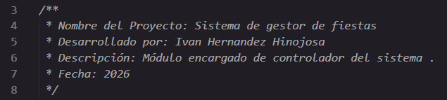
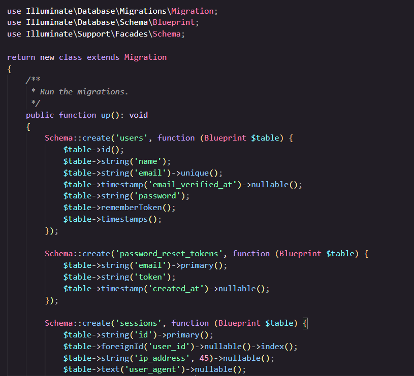
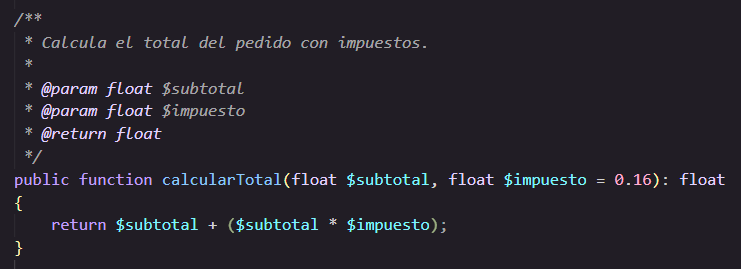
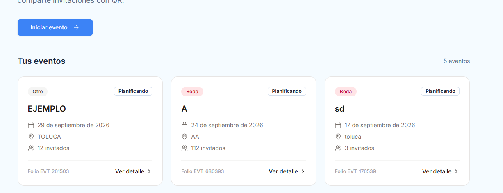
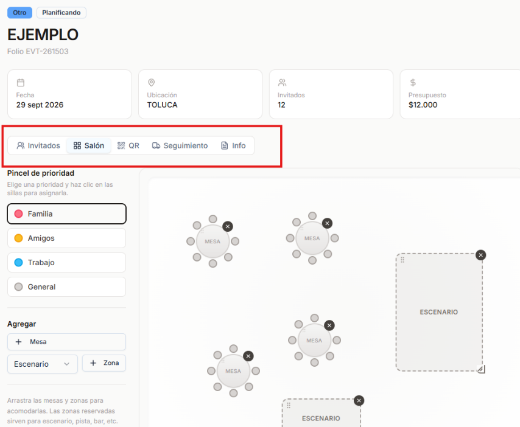
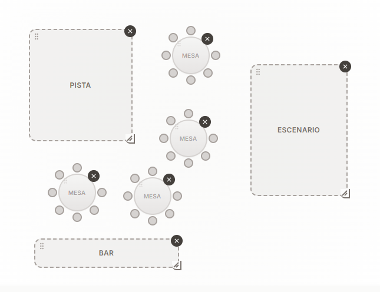

**  ****Ingen****iería**** en software**
**Unidad de aprendizaje:**
**Auditoria de sistemas**
**Empresa ****Bigbitbyte**
**Profesor:**

**Mauro Sánchez ****Sánchez**
**Manual de programación**
**Estudiantes****:**
Ivan Hernández Hinojosa
Jorge Darien Cabrera Bastidas
Carlos González Laines
**Fecha de entrega:** **22****/****Septiembre****/202****6**

# Elaboración

El presente manual fue elaborado por el equipo de Bigbitbyte, integrado por:

> **Ilustración 1. Tabla de elaboración**

| N.° | Integrantes |
| --- | --- |
| 1 | Jorge Darien Cabrera Bastidas |
| 2 | Carlos Gonzalez Laines |
| 3 | Ivan Hernandez Hinojosa |

# Control de Versiones

La siguiente tabla registra el historial de cambios del presente manual, Toda
modificación posterior a su aprobación debe quedar asentada en la siguiente tabla:

| Versión | Fecha | Autor | Descripción |
| --- | --- | --- | --- |
| 1.0 | 11/09/2026 | Ivan Hernandez Hinojosa | Identificación de los puntos a añadir acorde a la tabla de evaluación del manual |
| 2.0 | 14/09/2026 | Ivan Hernandez Hinojosa | Se elaboraron los puntos identificados y quedo a evaluación del equipo para correcciones del manual. |

> **Ilustración 2. Tabla de control de versiones**

Tabla de contenido
Tabla de ilustraciones

> **Ilustración 2. Tabla de control de versiones PAGEREF _Toc240922162 \h 2**

> **Ilustración 1 Ejemplo de cabecera del prólogo PAGEREF _Toc240922163 \h 4**

> **Ilustración 2 Ejemplo de sangría a seguir a lo largo del código PAGEREF _Toc240922164 \h 4**

> **Ilustración 3 Ejemplo de formato en los métodos PAGEREF _Toc240922165 \h 5**

> **Ilustración 4 Ejemplo de la versión demo de cómo se verán los fondos en el sistema web PAGEREF _Toc240922166 \h 7**

> **Ilustración 5 Logo a usar en el sistema (Empresa Bigbitbyte) PAGEREF _Toc240922167 \h 7**

> **Ilustración 6 Ejemplo de la versión demo de cómo se van a ver los menús en el sistema web PAGEREF _Toc240922168 \h 8**

> **Ilustración 7 Ejemplo de la versión demo de como varían las formas de los componentes PAGEREF _Toc240922169 \h 9**

# 1. Formato del código

## 1.1 Cabecera del prólogo.

Al inicio de cada archivo de script PHP, se debe incluir un bloque de comentarios formateado (PHPDoc) que proporcione la metainformación del archivo. Debe incluir la identificación de la empresa desarrolladora, los nombres de los desarrolladores/integrantes del equipo, la fecha de creación/modificación y una breve descripción general de las funciones que gestiona el archivo.

> **Ilustración 1 Ejemplo de cabecera del prólogo**

## 1.2 Sangría.

Se debe utilizar una sangría uniforme de 4 espacios (o 1 tabulación configurada a 4 espacios) por cada nivel de anidación. La extensión PHP Tools for VS Code automatiza la alineación del código al guardar el archivo (Format on Save), garantizando una jerarquía visual clara de los bloques, funciones y estructuras de control.

> **Ilustración 2 Ejemplo de sangría a seguir a lo largo del código**

## 1.3 Estructura de condicionales.

Las estructuras condicionales (if, else, elseif, switch) deben mantener la siguiente estructura de formateo:
- Las aperturas de llaves “{” deben ubicarse en la misma línea que la instrucción condicional, precedidas por un espacio.
- Las llaves de cierre “}” se colocan en una línea independiente alineada con el inicio del condicional.
- Todas las condiciones complejas deben evaluarse claramente usando paréntesis. La extensión proporciona autocompletado de sintaxis e IntelliSense para agilizar su escritura.

## 1.4 Ciclos.

Los bucles de control (for, foreach, while, do-while) deben estructurarse de la siguiente manera:
- Se debe dejar un espacio entre la palabra clave del ciclo y el paréntesis de apertura.
- El bloque de código dentro del ciclo debe tener un nivel de sangría adicional.
- En bucles foreach, se recomienda definir claramente los tipos de los elementos iterados utilizando anotaciones para que la extensión ejecute análisis estático (PHPStan / Psalm) y evite errores de tipo durante la ejecución.

## 1.5 Métodos.

La declaración de funciones y métodos dentro de clases debe cumplir con las siguientes reglas:
- Las aperturas de llaves “{” deben colocarse en la línea siguiente a la definición de la función/método.
- Los parámetros deben especificar su tipo de dato (Type Hinting) y valor por defecto si aplica.
- Todos los métodos deben incluir un bloque de documentación PHPDoc indicando los parámetros @param y el tipo de retorno @return.

> **Ilustración 3 Ejemplo de formato en los métodos**

## 1.6 Formatos.

Para asegurar la cohesión visual en todo el proyecto:
- Todo el código debe ceñirse a los estándares estándar de formateo de PHP (PSR-12).
- Cada sentencia debe finalizar estrictamente con punto y coma ;.
- Los operadores (=, +, ==, ., etc.) deben llevar un espacio antes y después de su posición.
- El formateador de la extensión PHP Tools se encargará de corregir automáticamente espaciados, alineaciones de arreglos y saltos de línea innecesarios.

### ***1.7 Nomenclatura de las variables, métodos, clases y comentarios.****** ***

Se deberán aplicar las siguientes convenciones de nomenclatura para mantener un código profesional y mantenible:
- Clases: Se deben nombrar utilizando PascalCase (ejemplo: UsuarioController, ConexionBaseDatos).
- Métodos y Funciones: Se deben nombrar utilizando camelCase indicando una acción/verbo (ejemplo: obtenerUsuario(), eliminarRegistro()).
- Variables: Se escribirán en camelCase con nombres descriptivos (ejemplo: $idUsuario, $listaProductos). Se deben evitar nombres genéricos o de una sola letra (salvo en contadores de ciclos como $i).
- Constantes: Se escribirán completamente en MAYÚSCULAS_CON_GUION_BAJO (ejemplo: MAX_INTENTOS_LOGIN, DB_HOST).
Mientas que los comentarios de código deben ser trabajados bajo los siguientes puntos:
- Comentarios de una sola línea mediante // para explicar bloques lógicos específicos dentro del código.
- Comentarios multilínea mediante bloques /** ... */ (PHPDoc) para documentar clases, propiedades y métodos.

## 2. Formato de interfaces.

## 2.1 Colores.

Al formar parte de la empresa B se llegó al acuerdo de que se utilicen los colores con los siguientes códigos:
color 1 #3B82F6 azul cielo
color 2 #60A5FA azul claro
color 3 #1F2937 cian-azul oscuro
color 4 #F0F9FF blanco

## 2.2 Fondos.

El sistema contara con un fondo plano de color #3B82F6 azul cielo, cada bloque de elemento del sistema llevara un fondo blanco con bordes redondos

> **Ilustración 4 Ejemplo de la versión demo de cómo se verán los fondos en el sistema web**

## 2.3 Logos.

El logo utilizado dentro del sistema será únicamente el que se acordó como empresa, deberá de estar presente en una esquina superior izquierda todo el tiempo en cada ventana.

> **Ilustración 5 Logo a usar en el sistema (Empresa Bigbitbyte)**

## 2.4 Distribución de la pantalla.

Los subtemas deberán de tener el tipo de letra “Times New Roman” en negritas, con un tamaño de fuente de 16. Con la denominación del número de tema al que pertenece, junto a el número de subtema que es.
, al igual de en la portada de presentaciones en caso de ser utilizado el formato.

## 2.5 Distribución de menús.

Los menús de detalles de cada evento deberán de contener un icono al lado de la palabra que identifique a que apartado nos dirigirá el menú seleccionado.

> **Ilustración 6 Ejemplo de la versión demo de cómo se van a ver los menús en el sistema web**

## 2.6 Tamaños de componentes.

Los componentes estarán principalmente determinados por campos de aproximadamente 150x100 PX, con estos campos se refieren los cuadros en blanco que separan un componente de otro, tanto como datos de información, como áreas para mostrar QR, personalizar el salón, dar seguimiento de proveedores y información del evento.

## 2.7 Formas de componentes.

Las formas de los componentes será en su mayoría recuadros con bordes redondeados, en especifico hablando de las áreas de cada apartado en el que se este ubicado. A excepción de los componentes personalizables del salón, donde se deberá de contemplar variedad en las formas de las mesas y sillas (las cuales deberán ser representadas por círculos), poder redimensionar espacios como escenarios, pistas u otros espacios.
En el caso de como se van a establecer los datos en la creación de un evento se tendrán los componentes en forma de formulario, con espacios para introducir los datos en cajas de texto rectangulares con borde redondeado.

> **Ilustración 7 Ejemplo de la versión demo de como varían las formas de los componentes**

## 2.8 Tipo de letra.

Dentro del sistema se ocupará el tipo de letra con fuente Arial, con tamaño de 12, 16 y 24 respectivamente para que todo el texto sea visible.

## 2.9 Formato de mensajes.

En el caso de mensajes que requieran ser notificados, estos se darán mediante una burbuja emergente que dará el respectivo mensaje y se podrá cerrar dando click en cualquier parte de la pagina web, o bien, en el icono señalado con un “X” en el mensaje en la parte superior derecha

## 2.10 Textos que identifiquen acciones e iconos asociados.

Los siguientes iconos han sido verificados que son de uso libre y no infringe ningún derecho de autor en su integración al sistema, así mismo, se acompañara del texto en una sola palabra que describa la acción a realizar a cada icono correspondientemente.

| Textos que identifiquen acciones | Icono definido |
| --- | --- |
| Invitados |  |
| QR |  |
| Información |  |
| Seguimiento |  |
| Modificar |  |
| Eliminar |  |
| Ubicación |  |
| Agregar |  |

# Bibliografía

Iconos de uso libre. Sitio de consulta: Sitio Oficial de Flaticon. Fecha de consulta: 14 de septiembre de 2026. https://www.pearson.com  [URL]
*Estilo de sangría _ **AcademiaLab*. (s. f.). Sitio de consulta: AcademiaLab. Fecha de consulta: 14 de septiembre de 2026. https://academia-lab.com [URL]